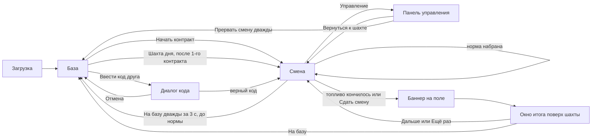

# Pixel Mine: карта UX по экранам

Цель: игрок в любой момент понимает, где он, что от него ждут и что будет после
нажатия. Ничего не пропадает без предупреждения, новое не сваливается разом.

Проверено 2026-11-02 во встроенном браузере (просмотр `tools/review`, тот же движок, что
в проекте), на телефонной ширине 375 px, автотестами (`tests/test-engine.mjs`,
`tests/test-campaign.mjs`, эталонный прогон) и запуском Preview в Construct 3.

## Переходы

## Экраны

### 1. Загрузка
- **Видит:** тёмный экран и надпись «Шахта загружается…» (в Construct его штатный загрузчик).
- **Страх:** пустой экран выглядит как зависание. **Решение:** надпись с первого кадра, картинки грузятся параллельно.
- **Проверено:** браузер. В просмотре загрузка 6–14 с: локальный сервер без кэша. В Construct грузит его загрузчик.

### 2. База (первый визит)
- **Видит:** заголовок «Контракт 1», карточку «Ллано, поле 4×4, топливо 22, норма 1800», рацию с вступлением Нюры, одну главную кнопку «Начать контракт 1», справку и строку о сохранении.
- **Скрыто до первой победы:** шахта дня, коды, мастерская, коллекция, «Копировать итог».
- **Страх:** слишком много кнопок и чужих слов («модули», «сборка», «код друга»). **Решение:** постепенное открытие (см. ../game/gamification.md).
- **Проверено:** браузер, чистый профиль; тест «a new bourmaster hears the intro».

### 3. База (после смены)
- **Видит:** итог одной фразой: при победе «Контракт выполнен: N из M, мастерство K из 3. Награда X кр. Следующий контракт открыт». При неудаче «Топливо закончилось: до цели не хватило N руды. За смену начислено X кр. Контракт можно начать снова, находки и кредиты остаются».
- **Рация:** новая сцена звучит один раз, после первой победы в контракте. Вступление не повторяется.
- **Открывается после первой победы:** шахта дня, мастерская с пояснением «Модули ставятся на корабль перед сменой», коллекция, если есть реликвии, «Копировать итог», если есть итог.
- **Проверено:** браузер (победа и поражение); тесты «the first win plays the next radio beat», «the intro is not repeated».

### 4. Мастерская (часть базы)
- **Видит:** модуль, уровень, что даст следующий уровень, цену; «Установить» или «Снять модуль».
- **Обратная связь:** строка статуса без точки в конце: «Аккумулятор: уровень 1, установлен, занято слотов 1 из 2», «оба слота заняты: сними другой модуль».
- **Недоступно:** кнопка серая, цена видна.
- **Проверено:** браузер; тесты покупки и слотов.

### 5. Смена
- **Видит:** поле нужного размера между лестницей и шахтой, цель и прогресс над полем, корабль в туннеле, шкалу топлива, строку подсказки над трюмом, три слота трюма, «На базу».
- **Первый ход:** «Поменяй местами две соседние руды · Три одинаковые в ряд уходят в добычу».
- **Выбор:** выбранная руда крупнее, рамка, подсказка «Медь · 10 за кусок · Выбери соседнюю клетку».
- **Обмен без линии:** руда возвращается, топливо не тратится.
- **Линия:** руда исчезает, всплывают очки, корабль едет под столбец и бурит, строка «+N руды» или «Каскад ×2 · +N».
- **Спецфишка:** кольцо-вспышка, значок на руде, «Новая спецфишка · ракета по строке».
- **Находка:** показывается в клетке, затем ценность летит в трюм, топливная ячейка в шкалу топлива, взрывчатка гаснет на месте.
- **Топливо на исходе:** при 3 и меньше «Топливо на исходе: 3».
- **Проверено:** браузер; тесты движка (54) и кампании (48).

### 6. Норма выполнена
- **Видит:** «Норма выполнена · Всё сверх нормы идёт в карман», над полем «Норма выполнена, сверх нормы +N», кнопка «На базу» становится «Сдать смену».
- **Выбор:** копать дальше до конца топлива ради излишка или сдать смену одним нажатием (без подтверждения: ничего не теряется).
- **Проверено:** браузер; тесты «meeting the quota keeps the shift going», «after the quota one press hands the shift in».

### 6а. Конец смены и окно итога
- **Видит:** поле приглушается, крупно «Смена сдана» или «Топливо закончилось», затем поверх шахты небольшое окно: заголовок, звёзды, до четырёх строк (добыто, норма, сверх нормы, кредиты с пометкой повтора), реплика рации, если сюжет продвинулся, «Новое: …», две кнопки.
- **Кнопки:** «Дальше: контракт N» после победы, «Ещё раз» после неудачи, «На базу». Enter нажимает первую, Escape уводит на базу.
- **Страх:** отдельный экран-переход и непонятно, что дальше. **Решение:** итог в маленьком окне над шахтой, следующий шаг одной кнопкой.
- **Проверено:** браузер (Chrome, победа и поражение, «Дальше» запускает контракт 2); тест «a handed-in shift shows a banner on the field before the base».

### 7. Уход со смены
- **Первое нажатие** «На базу» или R: кнопка меняется на «Точно уйти?», подсказка «Нажми ещё раз, чтобы уйти на базу · Добыча этой смены пропадёт».
- **Второе нажатие** в течение 3 с уводит на базу без награды; иначе запрос сбрасывается.
- **Страх:** случайное касание стирает смену. **Решение:** двойное нажатие.
- **Проверено:** браузер; тесты «the first press of R only asks to confirm» и «the confirmation expires».

### 8. Панель «Управление»
- **Видит:** состояние одной строкой, кнопки звука, снятия выбора и прерывания (тоже с подтверждением), поле кнопками с названиями руд и спецфишек нужного размера, справку.
- **Проверено:** браузер (сетка шахты дня, подписи вида «Строка 1, столбец 1: Железо, 12 за кусок»).

### 9. Шахта дня и код друга
- **Шахта дня:** поле 6×6, топливо 20, без модулей и без кредитов (сказано на кнопке-пояснении).
- **Код:** диалог с подставленным кодом дня; неверный код даёт подсказку формата; «Отмена» закрывает.
- **Копировать итог:** если буфер недоступен, вместо внутреннего кода показывается код, который пригодится другу.
- **Проверено:** браузер.

### 10. Телефон
- **Ширина 375 px:** база и смена без горизонтальной прокрутки, кнопки не меньше 48 px, мастерская прокручивается.
- **Проверено:** браузер.

### 11. Вкладки базы
- **Когда видны:** вкладки появляются по мере открытия: База после 2-го контракта, Лаборатория после 5-го, Коллекция после 6-го, Флот после 7-го. Закрытых вкладок игрок не видит.
- **База:** сетка 6×6, выбор клетки, список того, что можно построить, «Забрать доход».
- **Лаборатория:** способности с ценой в заряде, слоты, лишнюю способность нельзя взять, пока слот занят (сказано текстом).
- **Коллекция:** четыре набора по слоям, ненайденное показано как «Не найдено» с редкостью, обмен лишних, «Подарить» у копий, открытка, летопись по рации.
- **Флот:** без дока объяснено, что его нужно построить; у корабля выбор слоя и длины рейса, в пути виден остаток времени, по возвращении «Разгрузить».
- **Код друга:** тот же диалог принимает код шахты PM2 и код подарка GIFT; ошибка в коде объясняется.

### Симуляция первого захода
- Пять агентов-персон (68 лет, 12 лет, фанат Royal Match, любитель стратегий, дальтоник) прошли путь новичка по кадрам с телефона. Итоги и правки в `persona-playtest.md`.
- Исправлено: «Трюм полон. Продано» (5 из 5), бледная «Сдать смену» (5 из 5), пустая база без цен (4 из 5), непонятные слова и кредиты.
- Повторная проверка: две самые строгие персоны теперь не бросили бы игру. Живой тест по `playtest.md` всё ещё нужен.

### Путь игрока
- Полный путь от первого запуска до игрового цикла описан в `specs/002-player-journey/spec.md`: одна новая система за контракт, о ней говорят итог, рация и подсвеченная вкладка.
- **Обучение контракта 1 (проверено в браузере):** ход 0 рамка на паре руд и «Поменяй две руды в рамке»; ходы 1–2 пульсируют добыча и топливо с подсказкой «Добыча растёт, норма 1800. Каждый ход стоит одно топливо»; после нормы пульсирует «Сдать смену».
- **Подсказка хода:** в любой смене после 6 секунд без выбора на ближайшем ходе пульсирует рамка.
- **Открытия:** итог контракта 2 пишет «Новое: открыта база. Плавильня приносит кредиты, подъёмник открывает места в трюме», вкладка «База» подсвечена латунью с пометкой «новое», пока её не откроют (проверено в браузере). Так же сообщаются мастерская, общежитие, Лаборатория, коллекция и флот.
- **Подсказки** теперь пузырём в полосе неба над полем, а не в тесной полосе над трюмом.
- **Руды** нарисованы заново в 256 px (наборы OCAL, CC0) и различаются цветом внутри слоя; проверено в Preview настоящего Construct.

### 0. Вступление
- **Когда:** перед первым контрактом, один раз. Три карточки: «Ллано, Техас, 1889» (кто ты и зачем копаешь), «Как добывать», «Что сверху нормы». Кнопки «Пропустить» и «Дальше», на последней «К работе».
- **Проверено в браузере:** чистый профиль показывает карточку «1 из 3», текст читается на 390 px.

### 11б. Меню «Пауза»
- **Видит:** узкую карточку поверх затемнённой шахты: строка «Контракт 9: добыча 0 из 5000, топливо 21, находок 0», кнопки «Продолжить», «Как играть», «Сюжет», звук, «Выйти на базу».
- **Выход:** первое нажатие «Точно выйти? Добыча пропадёт», второе возвращает на базу и закрывает меню.
- **Поле из кнопок** для экранного диктора спрятано от глаз, но осталось в разметке.
- **Проверено в браузере:** все пять кнопок, страницы «Как играть» и «Сюжет» с кнопкой «Назад», выход с подтверждением.

### 11а. Кабина смены
- **Шапка:** слева контракт и добыча «0 / 5000» (после нормы «сверх нормы +N»), справа находки за смену и кнопка меню. Когда норма выполнена, на месте находок появляется «Сдать смену».
- **Меню:** открывает панель «Управление» со звуком, справкой и «Прервать смену» (с подтверждением). Отдельной кнопки «На базу» больше нет.
- **Низ:** датчик топлива с числом под стрелкой, кнопка «i» со сведениями о корабле (трюм, топливо, шахтёры, способности; закрывается касанием), строка подсказки, трюм и способности с иконками и ценой в заряде.
- **Трюм:** в начале открыто одно место, два других под замком; касание замка объясняет, что место открывает подъёмник на базе (120 и 300 кредитов).
- **Чёткость:** все числа и подписи смены теперь текст страницы поверх холста, пиксельные шрифты рисуются в разрешении экрана.
- **Проверено в браузере:** меню открывает панель, «i» открывается и закрывается, «Сдать смену» появляется после нормы и открывает окно итога; iPhone 390×844, iPhone SE 375×667 и iPad 768×1024.
- **Проверено в Preview настоящего Construct:** кабина совпадает с холстом до пикселя (500×889), добыча «0 / 2700», топливо 21, иконки замков загрузились, без Лаборатории в нижнем ряду подсказка «Способности появятся с Лабораторией», ошибок в консоли нет.

### 12. Экраны устройств
- **Проверено в браузере, смена на поле 7×7:**

| Экран | Клетка | Панель над полем | Поле целиком |
| --- | --- | --- | --- |
| iPhone SE 375×667 | 44 px | не перекрывает | да |
| Android 360×800 | 42,5 px | не перекрывает | да |
| iPhone 14 390×844 | 46 px | не перекрывает | да |
| iPhone Pro Max 430×932 | 51 px | не перекрывает | да |
| Pixel 412×915 | 49 px | не перекрывает | да |
| iPad 768×1024 | 68 px | не перекрывает | да |
| iPad Air 820×1180 | 78 px | не перекрывает | да |
| Android-планшет 800×1280 | 85 px | не перекрывает | да |
| iPad горизонтально 1024×768 | 51 px | не перекрывает | да, по бокам поля |

- На узких телефонах верхняя панель прячет строку добычи и топлива (они есть на поле и на датчике) и остаётся в один-два ряда; раньше на iPhone SE она в три ряда наезжала на верхний ряд поля.
- Чёткость: картинки заранее увеличены без сглаживания (руды и объекты в 4 раза, фоны в 2), а игра рисует их со сглаживанием. Пиксели остаются квадратными, края не рвутся и не мылятся на экранах с высокой плотностью.
- Android 360 px уже 720 точек макета, поэтому клетка 7×7 там 42,5 px; это предел вертикального макета.

## Вид

- Страницы и окна нарисованы как кабина: тёмный контур, стальная панель с фаской, латунная главная кнопка, прямые углы. Цветных полос, линий-разделителей и точек-разделителей нет.
- Шрифты игровые: Press Start 2P в заголовках, кнопках и цифрах, Handjet в тексте. Оба с полной кириллицей (SIL OFL).
- Руды из одного набора (7Soul1, CC0): разные силуэты, а не одна форма разного цвета.
- Движение плавное: обмен с разгоном и торможением, падение с ускорением и приседанием, выбранная руда «дышит».

## Слова

- Ходы называются топливом: «топливо 22», «Топливо на исходе», «Топливо закончилось».
- Короткие подписи без точки в конце.
- Единица добычи: руда («+120 руды», «не хватило N руды»).

## Что ещё не закрыто

- Окно предпросмотра Construct я сам не вижу: редактор открывает его отдельно. Редактор запускает Preview без ошибок, саму игру в нём проверял пользователь.
- Вкладки База, Лаборатория, Коллекция и Флот открыты в браузере: пустые состояния объясняют, что построить, корабль уходит в рейс, подарок выдаёт код. Цикл Лаборатории пройден в браузере: взяты Динамит и Резак, в смене Динамит прицелился и взорвал центр поля (+1328 руды, топливо не тратится).
- Impeccable по каждой вкладке (`/tools/review/?demo&tab=shift|base|lab|collection|fleet`): замечаний нет после затемнения латунной кнопки, `text-wrap: pretty` для абзацев и заголовков 24 px.
- Провал в браузере: в контракте «Топливо закончилось», «До нормы не хватило N», утешительные +25 кредитов, «Ещё раз» и «На базу»; в шахте дня «Добыто» и «Лучший результат дня» без кредитов.
- Диалог кода в браузере: неверный код и подделанный GIFT объясняют ошибку, код PM2 с датой открывает шахту дня с топливом 20 (тогда 8×8, теперь 6×6).
- Телефон 375 px: все пять вкладок без горизонтальной прокрутки, кнопок ниже 44 px нет. Поля растут по контрактам 4×4 (1–2), 5×5 (3–5), 6×6 (6–8), 7×7 (9–12); шахта дня 6×6. Клетка подстраивается под поле, чтобы оно заполняло квадрат 595 точек между лестницей и шахтой: 112 точек на 4×4 и 5×5, 99 на 6×6, 85 на 7×7. На телефоне 375 px это 58, 58, 52 и 44 px: все не меньше рекомендуемых 44 px. Проверено в браузере: 4×4 (58 px, ход касаниями засчитан, +430 руды) и 7×7 (44 px, поле между лестницей и шахтой и над трюмом без наложений, без прокрутки). Вдобавок работает свайп: касание выбирает руду, движение пальцем дальше 24 точек меняет её с соседней, короткое дрожание остаётся касанием. Нормы пересчитаны симуляцией: успех жадного игрока от 93% на контракте 1 до 53% на контракте 12. В Preview настоящего Construct бот на контракте 2 (4×4) сначала не добрал 36 руды до нормы 2200, поэтому нормы первых двух контрактов снижены до 1800 и 2000. На новой сборке тот же бот прошёл контракт 2: «Смена сдана», три звезды, 2874 из 2000, +189 кредитов, реплика Илая Пратта, «Дальше: контракт 3». Ошибок в консоли нет.
- Смена до конца пройдена в браузере: норма выполнена с плашкой «сверх нормы», «Сдать смену» открывает окно итога (звёзды, добыто, норма, излишек, кредиты, реплика по рации, «Дальше: контракт 10», «На базу»).
- Preview в настоящем Construct, сборка до перехода на поля 4×4–7×7 (открыт вкладкой вместо всплывающего окна): база с контрактом 1 и рацией, смена с полем 7×7, ход дал +162 руды и снял одно топливо, первое нажатие «На базу» просит «Точно уйти?». Затем в Preview сыграна целая смена контракта 1 через доступное поле: 22 хода, добыто 3718 из 4000, окно «Топливо закончилось» с недостачей 282 и +40 кредитов, «На базу» вернул на базу с пояснением, что контракт можно начать снова, а находки и кредиты остаются, и первой находкой в коллекции. Ошибок в консоли нет.
- До перехода на поля 4×4–7×7 (тогда первый контракт был 7×7): бот дважды не дотянул до нормы 4000 в контракте 1 (3718 и 3850). Первый контракт не должен отпугивать, норма снижена до 3500. На новой сборке в Preview тот же бот выполнил норму и доиграл смену: «Смена сдана», три звезды, 4856 из 3500, сверх нормы +1356, +201 кредит, реплика Марты Кёлер, «Новое: открыта шахта дня и повтор пройденных контрактов», «Дальше: контракт 2».
